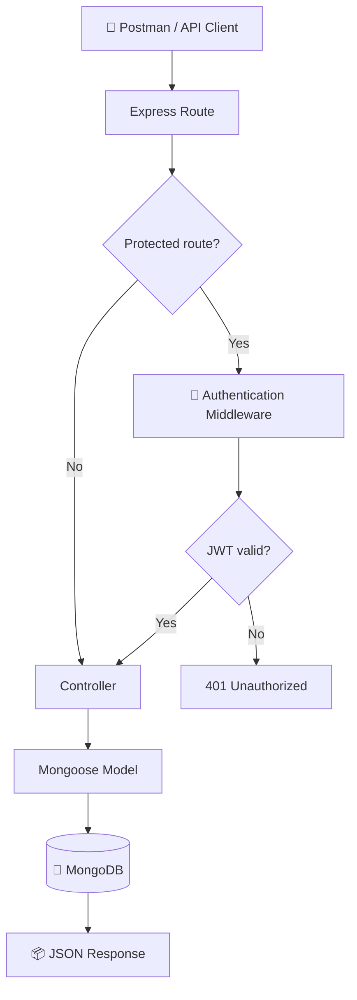
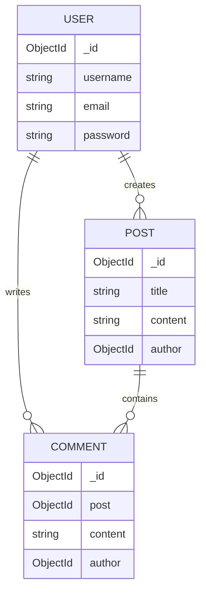
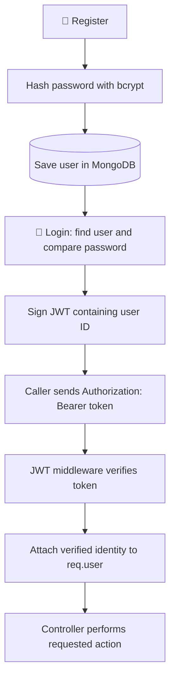
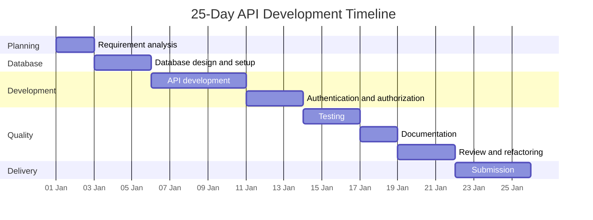

<div align="center">

# 📝 RESTful Blog Application API

### Backend REST API · 25-Day Development Plan

**Project ID: `SCR845NGFF`**

[](https://nodejs.org/)
[](https://expressjs.com/)
[](https://www.mongodb.com/)
[](https://mongoosejs.com/)
[](https://jwt.io/)
[](https://www.postman.com/)

**Build · Secure · Test · Document**

</div>

---

> [!NOTE]
> **Project scope:** This is a backend-only REST API, not a complete website. Use Postman to send HTTP requests and verify JSON responses. A frontend is not required.

## 📚 Table of contents

- [🌟 Project overview](#-project-overview)
- [✨ What the API does](#-what-the-api-does)
- [🧰 Technology stack](#-technology-stack)
- [🔄 Request lifecycle](#-request-lifecycle)
- [🗄️ Database design](#️-database-design)
- [🔌 API endpoints](#-api-endpoints)
- [🔐 Authentication and authorization](#-authentication-and-authorization)
- [🧪 Validation and HTTP status codes](#-validation-and-http-status-codes)
- [🗓️ 25-day development roadmap](#️-25-day-development-roadmap)
- [✅ Postman testing checklist](#-postman-testing-checklist)
- [📦 Repository and delivery checklist](#-repository-and-delivery-checklist)
- [🎯 Final deliverables](#-final-deliverables)
- [🔗 Project links](#-project-links)

---

## 🌟 Project overview

The **RESTful Blog Application API** allows users to:

- 👤 Register an account and log in.
- 🔑 Authenticate using JSON Web Tokens (JWT).
- 📰 Create, read, update and delete blog posts.
- 💬 Add, view, update and delete comments.
- 🛡️ Protect write operations and restrict changes to the content owner.

The API exchanges **JSON over HTTP**. MongoDB stores the application data, while Express.js handles incoming requests and routes them to the appropriate logic.

### 🎯 Main project objectives

1. Build RESTful endpoints for users, posts and comments.
2. Store data using MongoDB and Mongoose.
3. Secure passwords with bcrypt hashing.
4. Protect routes using JWT authentication.
5. Enforce ownership-based authorization.
6. Validate input and return meaningful HTTP responses.
7. Test the API using Postman.

## ✨ What the API does

| Area | Main capability |
|---|---|
| 👤 Users | Register and log in |
| 🔐 Authentication | Issue and verify JWT access tokens |
| 📰 Posts | Create, list, view, update and delete posts |
| 💬 Comments | Add, list, view, update and delete comments |
| 🛡️ Authorization | Restrict post/comment changes to their owners |
| ⚙️ Reliability | Validate input and return meaningful HTTP errors |

### 📌 Core rules

- 🌍 Anyone can read public posts and comments.
- 🔑 A valid JWT is required to create posts or comments.
- 👑 A user can update or delete only content they own.
- 🧾 The server determines the author from the verified token.
- 🚫 Never trust an `author_id` supplied by the caller.

## 🧰 Technology stack

| Technology | Responsibility |
|---|---|
| 🟢 **Node.js** | Runs JavaScript on the server |
| ⚡ **Express.js** | Defines API routes and handles HTTP requests |
| 🍃 **MongoDB** | Stores users, posts and comments as documents |
| 🧩 **Mongoose** | Defines schemas, references and database operations |
| 🔒 **bcrypt** | Hashes passwords before storage and verifies login passwords |
| 🎟️ **JWT** | Carries a signed user identity for protected requests |
| 🚀 **Postman** | Tests endpoints, request bodies, headers and responses |

## 🔄 Request lifecycle

The following diagram shows how a request travels through the application:



### 🧠 Important concepts

- **Route:** Connects an HTTP method and URL to an action.
- **Middleware:** Runs before the controller; verifies the JWT when required.
- **Controller:** Reads request data, performs the operation and sends a response.
- **Schema/Model:** Defines document fields and database behaviour.
- **MongoDB:** Persists the application data.

## 🗄️ Database design

The application uses three main MongoDB collections: `users`, `posts` and `comments`.

### 👤 `users` collection

| Field | Meaning |
|---|---|
| `_id` | Unique user ID generated by MongoDB |
| `username` | User's display name |
| `email` | Unique account email |
| `password` | bcrypt password hash; never plain text |
| `createdAt`, `updatedAt` | Timestamps |

### 📰 `posts` collection

| Field | Meaning |
|---|---|
| `_id` | Unique post ID |
| `title` | Post title |
| `content` | Main post content |
| `author` | ObjectId reference to the user who created it |
| `createdAt`, `updatedAt` | Timestamps |

### 💬 `comments` collection

| Field | Meaning |
|---|---|
| `_id` | Unique comment ID |
| `post` | ObjectId reference to the related post |
| `content` | Comment text |
| `author` | ObjectId reference to the user who wrote it |
| `createdAt`, `updatedAt` | Timestamps |

### 🔗 Collection relationships



A comment does not need to be embedded in the post document. Its `post` field stores the post's ObjectId. To get comments for one post, query the comments collection using that ID.

<details>
<summary>🧾 View an example post and its comment (click to expand)</summary>

**Post document**

```json
{
  "_id": "POST_ID",
  "title": "Learning Node.js"
}
```

**Comment document**

```json
{
  "_id": "COMMENT_ID",
  "content": "Helpful article!",
  "post": "POST_ID",
  "author": "USER_ID"
}
```

`POST_ID` in the comment links it to the matching post.

</details>

## 🔌 API endpoints

**Local base URL**

```text
http://localhost:5000/api
```

### 🔐 Authentication endpoints

| Method | Endpoint | Access | Purpose |
|---|---|---|---|
| `POST` | `/auth/register` | 🌍 Public | Create an account |
| `POST` | `/auth/login` | 🌍 Public | Verify credentials and receive a JWT |

### 📰 Post endpoints

| Method | Endpoint | Access | Purpose |
|---|---|---|---|
| `POST` | `/posts` | 🔑 Authenticated | Create a post |
| `GET` | `/posts` | 🌍 Public | List posts |
| `GET` | `/posts/:id` | 🌍 Public | Get one post |
| `PUT` | `/posts/:id` | 👑 Owner only | Update a post |
| `DELETE` | `/posts/:id` | 👑 Owner only | Delete a post |

### 💬 Comment endpoints

| Method | Endpoint | Access | Purpose |
|---|---|---|---|
| `POST` | `/comments` | 🔑 Authenticated | Create a comment |
| `GET` | `/comments?post_id=:post_id` | 🌍 Public | List comments for a post |
| `GET` | `/comments/:id` | 🌍 Public | Get one comment |
| `PUT` | `/comments/:id` | 👑 Owner only | Update a comment |
| `DELETE` | `/comments/:id` | 👑 Owner only | Delete a comment |

> [!IMPORTANT]
> Keep endpoint names and query parameter spelling consistent between the implementation, Postman collection and this guide.

### 📦 Example request bodies

<details>
<summary>👤 Register a user</summary>

```json
{
  "username": "naseem",
  "email": "naseem@example.com",
  "password": "Use-A-Strong-Password"
}
```
</details>

<details>
<summary>🔑 Log in</summary>

```json
{
  "email": "naseem@example.com",
  "password": "Use-A-Strong-Password"
}
```
</details>

<details>
<summary>📰 Create a post</summary>

```json
{
  "title": "Learning REST APIs",
  "content": "A REST API exposes resources through HTTP endpoints."
}
```
</details>

<details>
<summary>💬 Create a comment</summary>

```json
{
  "post_id": "REPLACE_WITH_POST_OBJECT_ID",
  "content": "This explanation was helpful."
}
```
</details>

> [!CAUTION]
> The author ID is **not** supplied in post/comment request bodies. It must come from the authenticated user identity in the verified token.

## 🔐 Authentication and authorization

### 🔄 Authentication flow



### 🔍 Authentication vs authorization

| Concept | Meaning |
|---|---|
| 🔐 **Authentication** | Is the request associated with a valid user identity? |
| 🛡️ **Authorization** | Is that user allowed to change this particular post or comment? |

For ownership checks, compare the resource's stored `author` ID with the verified `req.user` ID. A valid token alone does not grant permission to edit every resource.

### 🪪 Sending the JWT

For protected requests, include this HTTP header:

```http
Authorization: Bearer <your_jwt_token>
```

### 🚪 Logout note

With basic stateless JWT authentication, removing the token from the API client's saved authorization settings stops that client from sending it. The token remains valid until expiry unless server-side revocation/blacklisting is implemented.

## 🧪 Validation and HTTP status codes

Validate the following:

- Required fields.
- Email format and duplicate accounts.
- Password requirements.
- Non-empty post/comment content.
- Valid MongoDB ObjectIds.
- Existence of referenced posts.

### 📡 Common HTTP responses

| Status | Name | Example |
|---|---|---|
| `200` | 🟢 OK | Read or update succeeded |
| `201` | 🟢 Created | Post or comment created |
| `204` | 🟢 No Content | Resource deleted |
| `400` | 🟡 Bad Request | Missing field or invalid ID |
| `401` | 🟠 Unauthorized | Missing, invalid or expired JWT |
| `403` | 🔴 Forbidden | User tries to edit another user's content |
| `404` | 🟡 Not Found | Post, comment or user does not exist |
| `409` | 🟠 Conflict | Duplicate email |
| `500` | 🔴 Internal Server Error | Unexpected server failure |

> [!WARNING]
> Never return passwords, password hashes, JWT secrets, database credentials or production stack traces in API responses.

## 🗓️ 25-day development roadmap

Track your progress by checking off tasks as you complete them.

| Days | Phase | Expected outcome | Done |
|---|---|---|---|
| 1–2 | 🧭 Requirement analysis | Features and endpoint plan | [ ] |
| 3–5 | 🗄️ Database design and setup | Collections, schemas and relationships | [ ] |
| 6–10 | ⚙️ API development | Post and comment CRUD + validation | [ ] |
| 11–13 | 🔐 Authentication and authorization | Registration, login, JWT and ownership checks | [ ] |
| 14–16 | 🧪 Testing | Unit and integration tests | [ ] |
| 17–18 | 📖 Documentation | Optional API reference and short user guide | [ ] |
| 19–21 | 🧹 Review and refactoring | Cleaner, maintainable code | [ ] |
| 22–25 | 🚀 Submission | Final tested code pushed to GitHub | [ ] |

### 📊 Roadmap at a glance



> [!NOTE]
> The timeline above illustrates the sequence and duration of the 25-day plan. The dates are placeholders; use the day ranges in the roadmap table as the actual schedule.

## ✅ Postman testing checklist

Use this checklist to verify the API. Mark an item complete only after testing it.

### 👤 Authentication

- [ ] Register with valid details.
- [ ] Reject missing fields and duplicate email.
- [ ] Log in with correct credentials.
- [ ] Reject incorrect credentials.

### 🔐 Protected routes

- [ ] Access a protected endpoint with a valid token.
- [ ] Reject missing, invalid and expired tokens.

### 📰 Posts

- [ ] Create, list and retrieve posts.
- [ ] Update and delete posts.
- [ ] Prevent a user from editing or deleting another user's post.

### 💬 Comments

- [ ] Add comments and retrieve comments for the correct post.
- [ ] Update and delete comments.
- [ ] Prevent a user from editing or deleting another user's comment.

### ⚠️ Error handling

- [ ] Handle invalid IDs and references to missing posts.
- [ ] Check response status codes and JSON response bodies.

## 📦 Repository and delivery checklist

The repository currently exposes top-level folders such as:

```text
project-root/
├── config/
├── controllers/
├── middleware/
├── routes/
└── schema/
```

Keep responsibilities separated and make the README match the actual filenames and implementation.

### 🚀 Before submitting

- [ ] Database connection works.
- [ ] User, post and comment schemas are correct.
- [ ] All required endpoints work.
- [ ] Authentication and ownership checks work.
- [ ] Validation and error handling are consistent.
- [ ] Unit and integration tests pass.
- [ ] Postman collection or Swagger/OpenAPI documentation is included.
- [ ] Setup instructions match the actual project.
- [ ] `.gitignore` excludes `node_modules/`, `.env` and local files.
- [ ] No real credentials or secrets are committed to GitHub.

> [!CAUTION]
> If a real `.env` file or secret has already been pushed, adding it to `.gitignore` is not enough. Remove it from Git tracking and rotate any exposed credentials.

## 🎯 Final deliverables

The project submission should contain:

1. [ ] Working REST API for users, posts and comments.
2. [ ] MongoDB schemas and database setup.
3. [ ] JWT authentication and ownership-based authorization.
4. [ ] Input validation and error handling.
5. [ ] Unit and integration test cases.
6. [ ] API documentation and example requests.
7. [ ] Final source code in the GitHub repository.

## 🔗 Project links

- 🐙 **GitHub repository:** [Naseem-ux/Blog-Application-API](https://github.com/Naseem-ux/Blog-Application-API)
- 🆔 **Project ID:** `SCR845NGFF`

---

<div align="center">

### 💡 Build it right. Secure it well. Test every endpoint.

**Implementation status:** This guide describes the assignment requirements and intended behaviour. Mark a feature complete only after it is implemented and tested in the repository.

</div>
